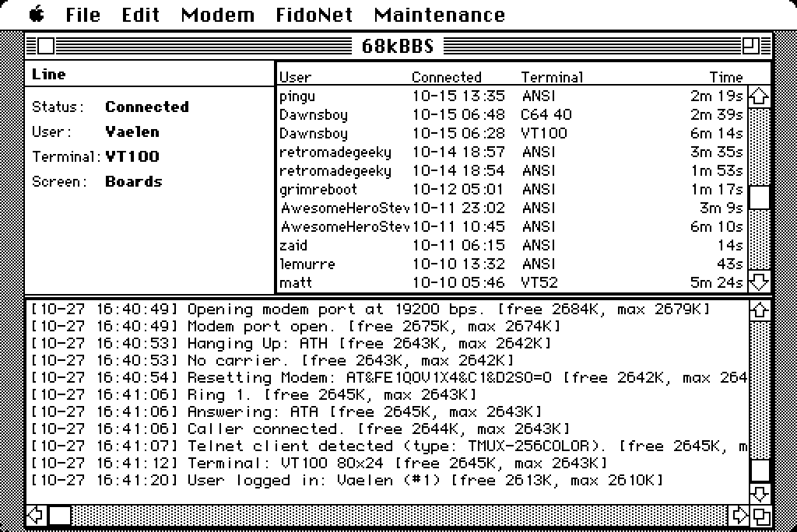

# 68kBBS

A bulletin board system for 68k Macintosh (System 6/7), written in
[Clarus](https://github.com/vaelen/clarus), serving callers over the
Mac's modem serial port. The goal is a period-authentic BBS that runs
on real hardware and supports a wide range of retro terminals (ASCII,
ANSI, VT100) as clients.



## Features

- **Mac app**: a main window with line status, a recent-callers table
  and a scrolling log; Modem, FidoNet and Maintenance menus. Runs on
  System 6 and 7. Two companion apps: 68kBBS Config (edit settings
  while the BBS is down) and 68kBBS Bench (micro-benchmarks).
- **Modem handling**: Hayes `RING`/`CONNECT`/`NO CARRIER` detection
  filtered out of the input stream, answer on N rings, configurable
  init string, port and speed (300-57600), paced `+++`/`ATH` hang-up,
  idle timeout.
- **Telnet-aware sessions**: a connect-time probe puts telnet clients
  in character mode with local echo off, tracks window size (NAWS),
  terminal type and speed, negotiates BINARY for transfers; plain
  modem callers are untouched (`docs/telnet-negotiation-reference.md`).
- **Terminals**: ANSI (CP437), VT100 (DEC Special Graphics), ASCII,
  VT52, Apple II and C64 PETSCII, color or mono, 40 or 80 columns;
  box-drawn tables and paged views (`docs/tables.md`), plus
  per-terminal welcome screens under `:Screens:`.
- **Accounts**: a [vDB](https://github.com/vaelen/libvdb)-format user
  database (pure-Clarus engine: `btree.cla`/`vdb.cla`, journaled with
  crash recovery and secondary indexes); signup, case-insensitive
  login, per-user access flags (`docs/access.md`), banned usernames
  (`docs/banned.md`). The first account becomes the sysop.
- **Message boards**: board picker, paged post lists, framed reader,
  threaded replies, and a WWIV-style line editor with the classic
  `/S /A /L /D /E /I /R` commands (`docs/boards.md`).
- **Private mail and FidoNet**: local mail and netmail, echomail
  boards, and EMSI/ZMODEM polls of an uplink with toss and scan
  (`docs/mail.md`, `docs/fidonet.md`).
- **File areas**: per-area file databases over ordinary Finder
  folders; XMODEM, XMODEM-1K, YMODEM and ZMODEM (with resume and
  multi-file uploads) downloads and uploads, uploads held for sysop
  approval (`docs/files.md`, `docs/file-transfers.md`).
- **Games**: a GW-BASIC-flavored BASIC interpreter running the sysop's
  `.BAS` programs (Super Star Trek ships as the sample) and an `Ok`
  prompt for sysops (`docs/basic.md`, `basic/langref.md`); Daily Word,
  a built-in daily word puzzle with leaderboards (`docs/daily-word.md`).
- **Community**: the Wall (`docs/wall.md`), a Message of the Day
  (`docs/motd.md`), and a recent-logins list.
- **Sysop menu**: users, boards, file areas, networks, games, banned
  names, configuration, MOTD and the log, all from a caller's terminal.
- **Maintenance**: a nightly run that expires old posts and compacts
  message heaps, plus a manual database compaction
  (`docs/maintenance.md`).

Not done yet: Kermit, tag-and-download batches, Z-code and Hermes
externals, and message search (`TODO.md`).

## Building

Requirements:

- `clarusc`, the [Clarus](https://github.com/vaelen/clarus) compiler,
  installed and on `PATH` (see that repo's README for how to install it)
- `cc`, for the host-lane tests
- optional: `lrzsz`, `socat` and `python3`, for the file-transfer and
  FidoNet end-to-end tests (`scripts/xmodem-e2e.sh`, `scripts/ftn-e2e.sh`)

```sh
scripts/build.sh    # 68k Mac app -> build/68kBBS.bin (MacBinary)
scripts/test.sh     # host-lane test suites (tests/*.cla)
```

## License

MIT — see [LICENSE](LICENSE).

Copyright 2026, Andrew C. Young <andrew@vaelen.org>
